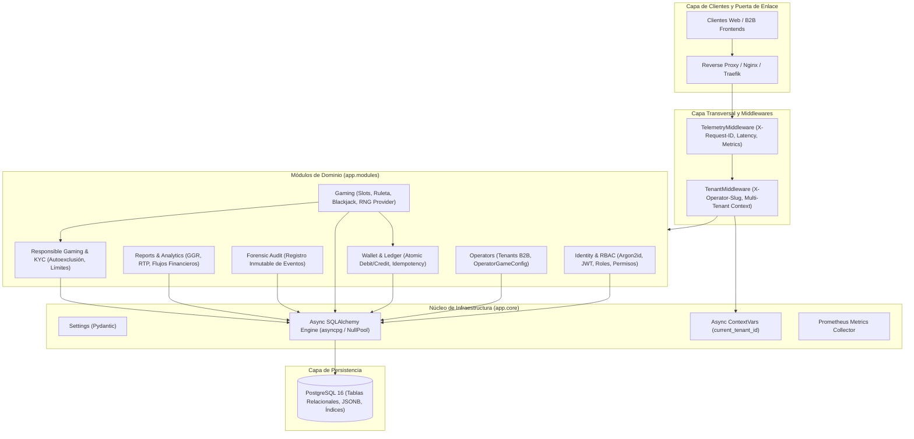

# Arquitectura del Sistema — CasinoCore

## 1. Visión General y Patrón Monolito Modular

**CasinoCore** está construido siguiendo el patrón de diseño arquitectónico **Monolito Modular (Modular Monolith)**. Este enfoque combina las ventajas operativas y transaccionales de un despliegue unificado con la disciplina de separación de dominios propia de una arquitectura de microservicios.

### 1.1 Justificación Arquitectónica
* **Transaccionalidad Atómica (ACID)**: En una plataforma de juegos de azar con billeteras virtuales y apuestas en tiempo real, garantizar que el débito de una apuesta, la ejecución de la ronda y la eventual acreditación de premios ocurran de manera estrictamente atómica es prioritario. El monolito modular permite ejecutar estas operaciones dentro de una sola transacción de PostgreSQL 16 con aislamiento `READ COMMITTED` y bloqueos pesimistas (`SELECT FOR UPDATE`), eliminando la complejidad y los puntos de fallo de transacciones distribuidas (Two-Phase Commit o sagas complejas).
* **Alta Cohesión y Bajo Acoplamiento**: El código se organiza en módulos de dominio autónomos (`identity`, `operators`, `wallet`, `gaming`, `responsible`, `audit`, `reports`). Cada módulo encapsula sus propios modelos ORM, esquemas Pydantic, servicios de lógica de negocio y enrutadores de FastAPI.
* **Simplicidad Operativa y Despliegue Unificado**: Un único artefacto de despliegue en contenedor Docker simplifica el pipeline de CI/CD, reduce la sobrecarga de infraestructura y facilita la observabilidad de extremo a extremo sin latencias de red interservicios.

---

## 2. Diagrama de Capas y Relación de Módulos

El siguiente diagrama ilustra la arquitectura de componentes de CasinoCore, mostrando el flujo de las peticiones desde el borde de red hasta la capa de persistencia:

---

## 3. Modelo Transaccional y Libro Mayor Inmutable (Immutable Ledger)

El corazón financiero de CasinoCore reside en su arquitectura de **Libro Mayor Inmutable de Solo Inserción (Append-Only Ledger)**.

### 3.1 Principio de la Fuente de Verdad Contable
* La tabla `ledger_entries` actúa como la **fuente de verdad canónica (Source of Truth)** para todas las operaciones monetarias.
* Cada movimiento financiero genera un registro inmutable con los siguientes atributos clave:
  - `wallet_id`: Identificador de la billetera afectada.
  - `operator_id`: Identificador del operador propietario (aislamiento multi-tenant estricto).
  - `entry_type`: Clasificación formal (`CREDIT`, `DEBIT`, `BET_PLACED`, `WIN_PAYOUT`, `FAUCET_RELOAD`).
  - `amount`: Monto en créditos virtuales enteros (BigInteger).
  - `balance_before` y `balance_after`: Instantánea auditada del saldo inmediatamente antes y después de la operación.
  - `idempotency_key`: Clave única para evitar duplicidades de red.
  - `created_at`: Marca temporal UTC inmutable.

### 3.2 Caché de Saldo y Reconciliación Matemática
* La entidad `wallets` almacena un campo `balance` que actúa como caché de lectura de alto rendimiento.
* **Garantía de Consistencia**: Antes de cada actualización de saldo, se ejecuta un bloqueo `SELECT FOR UPDATE` sobre la fila de la billetera. La operación suma algebraicamente el monto al saldo y persiste simultáneamente el nuevo `LedgerEntry`.
* **Endpoint de Reconciliación (`/api/v1/wallet/reconcile`)**: Ejecuta una auditoría matemática en tiempo real:
  $$\text{Saldo Reconciliado} = \sum \text{Créditos} - \sum \text{Débitos}$$
  Si $\text{Saldo Caché} \neq \text{Saldo Reconciliado}$, el sistema detecta una anomalía contable de inmediato.

---

## 4. Estrategia de Aislamiento Multi-Tenant y Seguridad B2B

CasinoCore implementa un modelo de **Base de Datos Compartida con Esquema Compartido y Discriminador Lógico (`operator_id`)**, fortalecido mediante control asíncrono y middleware:

1. **Resolución de Contexto**: Cada petición entrante que apunte a rutas `/api/v1/` es evaluada por `TenantMiddleware`. Si se envía la cabecera `X-Operator-Slug`, se valida la existencia del operador activo en la base de datos y se fija su identificador en `current_tenant_id` (`contextvars.ContextVar`).
2. **Validación Anti-Suplantación (Cross-Tenant Prevention)**: Si la petición incluye un token JWT de un jugador u operador admin, el middleware verifica que el `operator_id` presente en el token coincida con el operador resuelto. Si difieren, la petición se interrumpe de inmediato con `HTTP 403 Forbidden`.
3. **Catálogos Dinámicos por Operador (`OperatorGameConfig`)**: Cada operador puede activar o desactivar juegos individualmente y establecer sus propios límites de apuesta mínima y máxima (`min_bet`, `max_bet`), permitiendo diferentes políticas comerciales en la misma plataforma compartida.
4. **Defensa contra BOLA y Zero Data Leakage**: Las consultas de recursos por ID (`wallet_id`, `session_id`, `round_id`) validan la pertenencia al tenant. Si se solicita un ID perteneciente a otro operador, la plataforma responde `HTTP 404 Not Found`, evitando la enumeración de recursos privados.

---

## 5. Hoja de Ruta para Descomposición en Microservicios

Si la escala de tráfico o las necesidades organizacionales justifican la transición a microservicios independientes, CasinoCore está preparado para descomponerse gradualmente mediante el patrón **Strangler Fig**:

### 5.1 Fases de Separación Recomendadas
1. **Fase 1: Extracción del Motor de Juegos (Gaming Service)**:
   - Los motores de juego (tragamonedas, ruleta, blackjack) consumen cómputo intensivo (cálculo de RTP, evaluación de matrices de rodillos, barajado de cartas).
   - Se extraen como un microservicio independiente sin acceso directo a la base de datos de billeteras, comunicándose con el servicio de Billetera a través de una API interna gRPC o eventos asíncronos.
2. **Fase 2: Billetera y Ledger Transaccional (Wallet Core Service)**:
   - Se aísla como un servicio autónomo con su propia base de datos PostgreSQL de alta disponibilidad y réplicas de lectura.
   - Implementa el patrón **Transactional Outbox** para publicar eventos de dominio (`WalletDebited`, `WalletCredited`) hacia un bus de mensajes (Apache Kafka o RabbitMQ).
3. **Fase 3: Servicio de Identidad y Autenticación (IAM Service)**:
   - Emite tokens JWT firmados asimétricamente (RS256 o Ed25519) utilizando pares de claves pública/privada, permitiendo que todos los microservicios verifiquen tokens localmente sin consultar una base de datos centralizada.
4. **Fase 4: Módulos Analíticos y de Auditoría (Audit & Reporting Service)**:
   - Se alimenta consumiendo streams de eventos de Kafka, persistiendo en almacenes optimizados para lecturas analíticas (ClickHouse o TimescaleDB).
